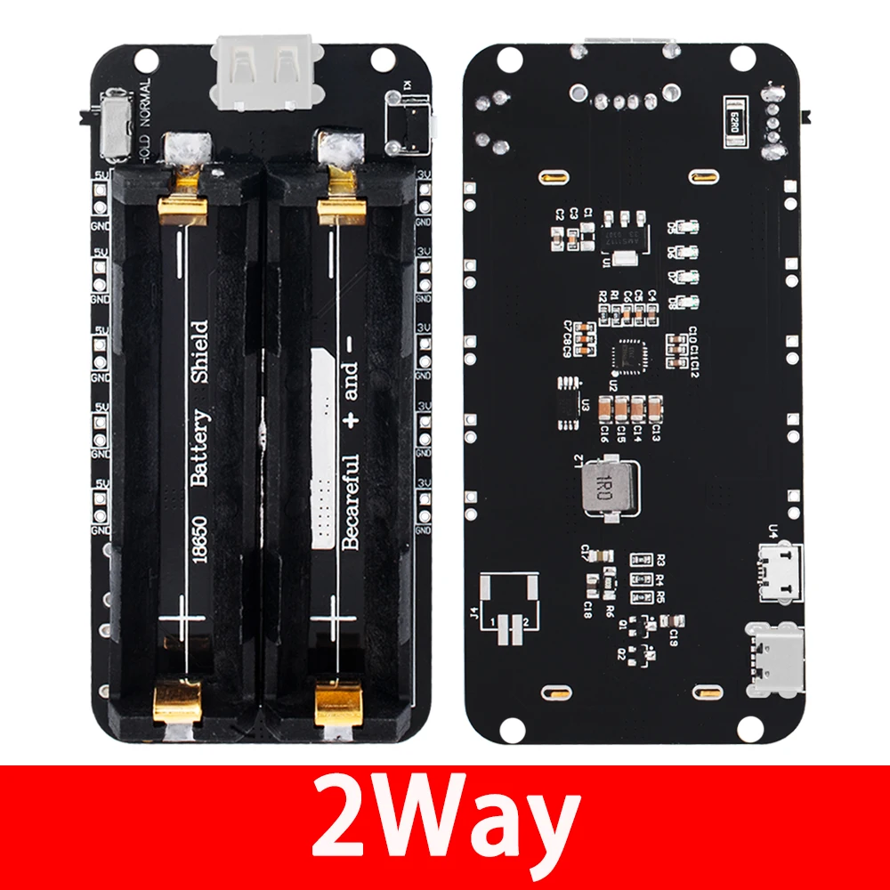
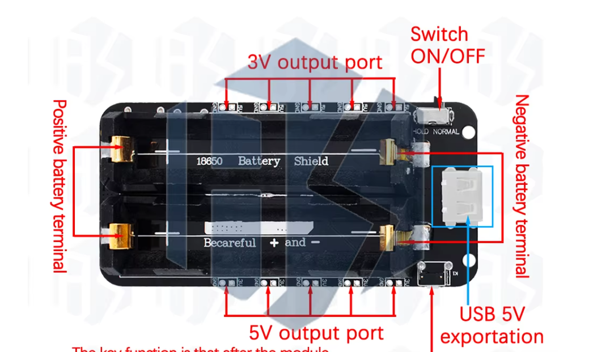
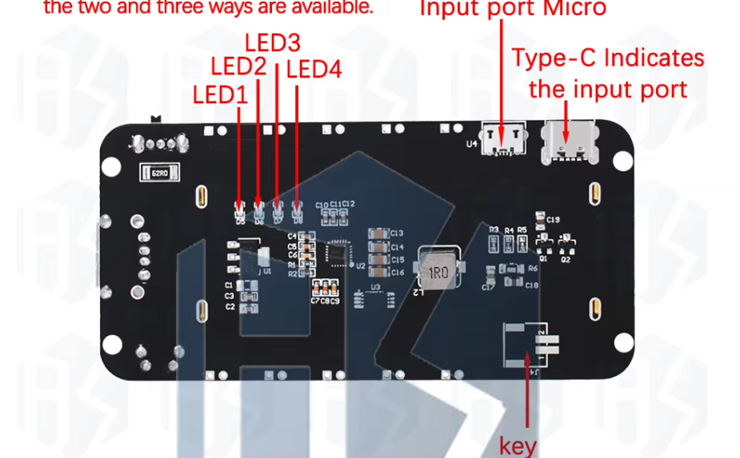

# ESP32

## Ultra sound sensor

HC-SR04

## 18650 Battery Shield V8 (2-way)

Baishun 18650 battery shield, 2-cell variant (1WAY/2WAY/4WAY exist). Bought on [AliExpress](https://www.aliexpress.com/item/1005008131562459.html).

### Specs

- Holds 2x 18650 cells; 100.3 x 48 mm, 39.41 g
- Outputs: 5V/3A and 3V/1A (listing figures)
- Output: USB-A socket, plus 5V+GND and 3V+GND solder pads along the long edges
- Charging input: Micro USB and USB-C (back of the board)
- 4 status LEDs, HOLD / NORMAL slide switch
- Back: boost converter (1R0 inductor), QFN controller (U2), SOT-223 regulator that looks like an AMS1117 (U1), K1 switch footprint, empty J4 2-pin footprint
- Not stated: charge current, cell protection, whether cells are in parallel

### Gotchas (from reviews)

- 5V output is stable
- HOLD mode keeps power on at very low load (~10mA), but it does not repower an ESP that has gone into deep sleep
- The LEDs stay on while powering a load and can't be switched off, so they are a constant drain
- Check cell polarity: the board is marked "Becareful + and -"
